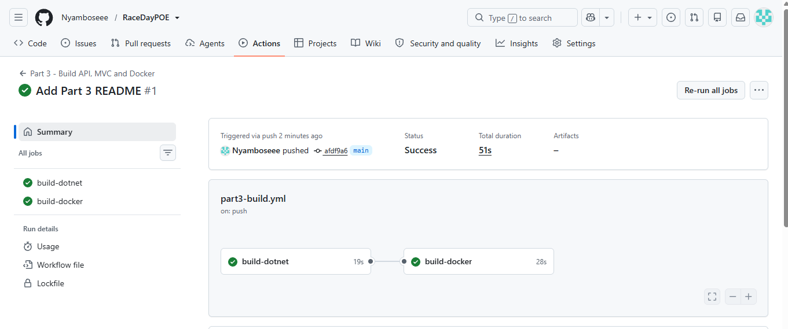

# RaceDay - Part 3: MVC Web App, Azure Blob Storage and Docker

RaceDay is an event management platform for South African road running, walking and cycling
events. Part 3 adds the web front end: an ASP.NET Core MVC app that talks to the Part 2 API, a
role-aware interface for **Organisers** and **Participants**, image uploads stored in
**Azure Blob Storage**, and **Docker** so the whole platform starts with one command.

## Roles

- **Organiser** - dashboard with events, enrolment totals and upcoming dates; creates, edits and
  deletes events (with a banner image); manages categories; sees who enrolled and confirms
  enrolments; captures finish times and positions after the event.
- **Participant** - browses and filters upcoming events; opens an event to see its categories;
  enrols in a category; sees their enrolments and status; sees their race history ("47th of 312
  finishers"); edits their profile and uploads a profile picture.

Each role gets its own navigation menu, and pages for the other role are blocked.

## Project layout

```
Part3/
  RaceDay.Api/          the Part 2 API, extended for Part 3 (Blob Storage, enrolment status)
  RaceDay.Web/          the MVC web app (no database access, calls the API only)
  Database/             RaceDay_Part3_Update.sql
  docker-compose.yml    SQL Server + API + web app
  RaceDay.Part3.slnx
```

The Part 2 folder is left as submitted. Part 3 starts from a copy of that API.

## Run it with Docker (one command)

You need Docker Desktop. From the `Part3` folder:

```
docker compose up --build
```

Then open:

- Web app: http://localhost:5100
- API and Swagger: http://localhost:5012/swagger

This starts a SQL Server container, the API and the MVC app. The API creates the database tables
the first time it starts. To stop everything: `docker compose down` (add `-v` to also wipe the data).

### Image uploads in Docker

Uploads need an Azure Storage connection string (see below). Copy `.env.example` to `.env`, put
the connection string in it, then run the same command:

```
copy .env.example .env
docker compose up --build
```

The `.env` file is in `.gitignore`, so the connection string is never committed. Without it
everything works except uploading banners and profile pictures.

## Run it without Docker

1. Run `Database/RaceDay_Part3_Update.sql` in SSMS against your existing `RaceDayDB`. It adds the
   enrolment status, banner and profile picture columns and keeps your data.
2. Save the Azure connection string as a user secret (this stays on your computer):
   ```
   cd Part3\RaceDay.Api
   dotnet user-secrets set "AzureBlob:ConnectionString" "<your connection string>"
   ```
3. Start the API: `dotnet run` in `Part3\RaceDay.Api` (listens on http://localhost:5012).
4. In a second terminal, start the web app: `dotnet run` in `Part3\RaceDay.Web`
   (http://localhost:5100).

The web app finds the API through `Api:BaseUrl` in `RaceDay.Web/appsettings.json`.

## How the MVC app works

- **No database code in the MVC project.** Every action calls the API through one `ApiClient`
  class. Business rules (ownership checks, duplicate enrolments, validation) stay in the API.
- **Session management.** When someone logs in, the MVC app calls `POST /api/auth/login`, keeps the
  API's session cookie in a server-side session, and signs the user in with its own cookie that
  carries their name and role. Every later API call sends the stored API cookie, so the role is
  checked in both places. Logging out clears both. If the API session expires, the user is sent
  back to the login page.
- **Role-based pages.** Controllers use `[Authorize(Roles = ...)]`. Anonymous users go to the
  login page, and the wrong role gets an access page.
- **Graceful errors.** Form input is validated before it reaches the API, API messages are shown
  as readable text, and if the API is down the user sees a friendly page instead of an error.

## Azure Blob Storage

The MVC app never talks to Azure. It sends the image to the API
(`POST /api/events/{id}/banner` and `POST /api/profile/me/picture`), and the API uploads it with
the `Azure.Storage.Blobs` package into two containers, `event-banners` and `profile-pictures`.
The API saves the blob URL on the event or participant, and the pages show the picture from that
URL. Uploads accept JPG, PNG or WEBP up to 5 MB.

Setup used for this project: an Azure Storage account (Standard, LRS) with blob public read
access switched on so the browser can load the images.

## Changes to the API in Part 3

- Enrolments now have a **Status**: new enrolments are `Pending` and the organiser sets them to
  `Confirmed` (`PUT /api/enrollments/{id}/status`).
- `POST /api/events/{id}/banner` and `POST /api/profile/me/picture` for image uploads.
- Events return `bannerUrl`, `enrollmentCount` and `categoryCount`; the organiser's enrolment list
  includes each person's result; `GET /api/results/me` includes `totalFinishers`.

## CI/CD

`.github/workflows/part3-build.yml` builds the API and the MVC app and then builds the Docker
images on every push. The Part 2 workflow still runs the unit tests.



## Video walkthrough


https://youtu.be/Nugqb1D1Prg

## AI tool disclosure

I used Claude (an AI assistant) throughout this part. It helped me plan the structure, draft the
MVC controllers, views, API changes and Docker files, and explain the concepts behind them, such
as session handling, Blob Storage and containers. I set up the Azure storage account and Docker,
put the code into the project, ran it, fixed the errors I hit along the way, tested both roles
in the browser, and made the commits myself. I explain the code in my video.
