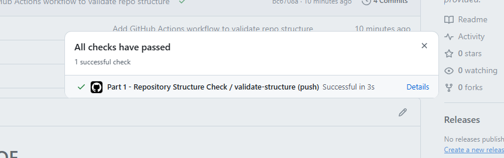

# RaceDayPOE

## About RaceDay

RaceDay is a full-stack event management platform built for the South African road running,
walking, and cycling community. Event Organisers can create and manage events, categories, and
participant results, while Participants can browse upcoming events, enter events, track their
personal performance history, and prepare for race day using route and weather information.

This repository currently contains **Part 1** of the Portfolio of Evidence: the system planning
and database work completed before any application code was written.

## Roles

- **Organiser** - creates, edits, and deletes events; manages event categories; captures
  participant results; views all enrolments for their events.
- **Participant** - creates an account; browses events; enters a category within an event;
  views their own enrolments; tracks their personal results across events.

## Repository Structure (Part 1)

```
/docs
  RaceDay_ERD.png                     - Entity Relationship Diagram (Section A)
  RaceDay_API_Endpoint_Plan.md        - Full API endpoint plan (Section B)
  RaceDay_Schema.sql                  - Database creation + seed script (Section C)
.github/workflows/
  part1-structure-check.yml           - CI workflow validating this repo structure
```

## Database

The database (`RaceDayDB`) has six entities: `Users`, `Events`, `Categories`, `Enrolments`,
`Payments`, and `Results`. See `docs/RaceDay_ERD.png` for the full data model and
`docs/RaceDay_Schema.sql` for the script that creates and seeds it in SQL Server.

## CI/CD

A GitHub Actions workflow (`.github/workflows/part1-structure-check.yml`) runs on every push
and verifies that the `/docs` folder exists and contains the ERD, endpoint plan, and SQL script.

**Green build screenshot:** 

## Video Walkthrough
https://youtu.be/lYaCYsejOrk?si=xFMAh16LuZKEinb_


## AI Tool Disclosure

AI assistance (Claude) was used to help draft the API endpoint table
format, and generate the initial SQL schema/seed script, which were I then reviewed, tested in
SSMS, and adjusted. Analysis and final decisions on the data model and endpoint
design were my own.
